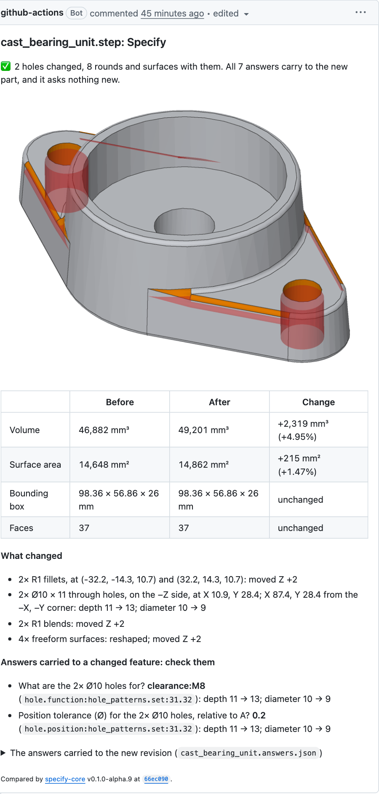

# Specify

**Add manufacturing intent to a STEP part, write it as AP242 semantic PMI, and keep it with the
part as the model changes.**

Specify reads a STEP part and recognises its features: holes, threads, hole patterns, slots,
bosses and turned diameters. It then asks what a drawing would need to say, and proposes an
answer, with its reason, for each question:

- the material;
- what each hole is for;
- which faces are datums;
- fits, threads, positions;
- surface finish and the general tolerance.

It writes your answers into the STEP file as AP242 semantic PMI, which CAD and inspection tools
can read, and verifies the file by reading it back. The answers are stored in the file too. When
the part changes, Specify carries them to the new revision and says what changed. An answer it
can't place is listed, never silently moved.

Specify captures manufacturing intent; it is not a DFM (design-for-manufacturability) checker.
It does not judge whether a part can be made, or how cheaply: wall thickness, tool access,
draft, internal radii or cost. The facts it reports — the features it recognises — can inform
that judgement, made by an engineer or an AI.

It is deterministic (rules and standards tables, no AI) and pure Rust: no OpenCascade, no
Python. Feature recognition and the STEP/AP242 kernel come from
[pzfreo/quiddity](https://github.com/pzfreo/quiddity).

**Try it in the browser, with nothing to install:**
- [**draftwright.io/specify**](https://draftwright.io/specify): open a STEP part, answer the questions in 3D, and download the STEP with its PMI.
- [**draftwright.io/diff**](https://draftwright.io/diff): compare two revisions of a part and see what changed.



## With AI and code-first CAD

Text-to-CAD and code-first tools (build123d, cadgen) now let an AI produce a part's geometry. What they don't produce is the manufacturing intent a supplier needs: datums, fits, threads, tolerances and finish. Specify is the deterministic half of that loop:

- **A question list an agent can work through.** `questions` returns each decision the part needs, with a proposed answer and its reason, as JSON. The agent (or a person) answers by question id. Nothing has to be written as free-form GD&T.
- **Checked, standard output.** Specify, not the AI, writes the AP242 semantic PMI and reads it back to verify it, so a wrong answer is refused, never silently turned into bad PMI.
- **Answers that survive regeneration.** Parts whose code names its faces keep their answers on the same faces when the model is rebuilt; Specify re-asks only about faces an edit touched ([docs/face-names.md](docs/face-names.md)).
- **Changes a reviewer can trust.** `diff` explains what changed between two revisions in engineering terms, on every pull request with the GitHub action, so an agent's edits are reviewable.

Call it from an agent through Python (`pip install specify-core`), the command line or the JSON-lines host process.

## Ways to use it

One engine, one set of answers and files, whichever way you call it:

| Use | Install | Guide |
| --- | --- | --- |
| **In the browser** | nothing: [draftwright.io/specify](https://draftwright.io/specify) and [draftwright.io/diff](https://draftwright.io/diff) | |
| **Command line** | a [release](https://github.com/pzfreo/specify-core/releases) binary, or `cargo build --release` | [below](#command-line) |
| **Python** | `pip install specify-core` (CPython 3.12+, no dependencies) | [below](#python), [package README](crates/specify-core-py/README.md) |
| **Rust** | `specify-core = { git = "https://github.com/pzfreo/specify-core", tag = "v0.1.12" }` | [below](#rust), [docs/library.md](docs/library.md) |
| **Browser** (WebAssembly) | `specify-core-wasm-<version>.tgz` on each release | [docs/wasm.md](docs/wasm.md) |
| **Host process** (JSON lines) | `specify-core serve` | [below](#host-process) |
| **GitHub pull requests** | `uses: pzfreo/specify-core/step-diff@main` | [step-diff/README.md](step-diff/README.md) |

[draftwright.io/specify](https://draftwright.io/specify) and
[draftwright.io/diff](https://draftwright.io/diff) run the WebAssembly build in the browser.

## Specify a part

The flow is the same everywhere:

1. **Analyse** the part.
2. **Answer** the questions. Each answer is a question id and a value, for example
   `{"part.material": "6082-T6", "hole.function:holes:9": "fit:H7"}`. Accept the proposed
   defaults for the rest, or answer every one.
3. **Write** a verified STEP file.

### Command line

```bash
specify-core analyse plate.step -o plate.analysis.json          # features, faces, existing PMI
specify-core questions plate.analysis.json --open                # what is still unanswered
echo '{"part.material": "6082-T6", "hole.function:holes:9": "fit:H7"}' > answers.json
# Export defaults explicitly, with face evidence, before writing:
specify-core questions plate.analysis.json --answers answers.json \
  --resolve-defaults --step plate.step > plate.complete.answers.json
specify-core write plate.step plate.analysis.json plate.complete.answers.json -o plate-pmi.step
```

`write` refuses until every question has an answer, or `--accept-defaults` supplies the rest.
It prints a JSON report with `output`, `written`, `not_written` and `warnings`. `not_written`
gives each reason, including an answer whose question is not asked given the other answers
([answers](docs/answers.md#answers-to-questions-not-asked)).

Exit codes:
- **0:** done.
- **1:** a write that didn't verify, or a file that can't be read.
- **2:** a refusal, such as an unanswered question, an invalid answer or bad arguments.

`specify-core mesh plate.step -o plate.mesh.json` writes the part's triangles grouped by face,
for a face picker.

`-o -` writes `analyse`'s or `mesh`'s JSON to stdout (the summary goes to stderr), for a pipe:
`specify-core analyse plate.step -o - | jq '.features[].family'`.

`specify-core open plate.step` opens the file in [draftwright.io/specify](https://draftwright.io/specify)
in your browser, with nothing to click and nothing uploaded: it serves the file once on
127.0.0.1, to the editor's origin only, and exits once the page has fetched it (or after 10
minutes). `--editor` opens the full editor instead, `--site ORIGIN` another deployment, and
`--no-browser` only prints the address. The first time, Chrome asks whether
"draftwright.io wants to access other apps and services on this device": Allow lets the page
fetch the file from 127.0.0.1, and is remembered. If the file did not open while that prompt
was up, stop the command (Ctrl-C) and run it again. If you chose Block, allow it again in
draftwright.io's site settings.

**Shell completion.** `specify-core completions SHELL` prints a completion script for `bash`,
`zsh`, `fish`, `powershell` or `elvish`:

```sh
specify-core completions bash > ~/.local/share/bash-completion/completions/specify-core
mkdir -p ~/.zfunc && specify-core completions zsh > ~/.zfunc/_specify-core
# zsh: add `fpath=(~/.zfunc $fpath)` before `compinit` in ~/.zshrc, then restart zsh
specify-core completions fish > ~/.config/fish/completions/specify-core.fish
```

### Python

```python
from specify_core import api

analysis = api.analyse("plate.step")

for q in api.questions(analysis, {}):                 # what is still unknown
    print(q.id, "|", q.prompt, "| default:", q.default)

answers = {"part.material": "6082-T6", "hole.function:holes:9": "fit:H7"}
intent = api.apply(analysis, answers, accept_defaults=True)
report = api.write("plate.step", intent, "plate-pmi.step", answers=answers)

print(report.written)       # ['datum A', 'Ø8 H7 on holes:9', 'position 0.05 on holes:9', ...]
print(report.not_written)   # anything not written, with the reason (an unasked answer too)
```

The other functions are listed in the [package README](crates/specify-core-py/README.md):
- `parts` and `load`, for assemblies and reading a file once;
- `preview`;
- `write_parts`;
- `mesh`;
- `diff`;
- `pmi_scene`.

### Rust

```rust
use std::path::Path;

use serde_json::{Map, Value, json};
use specify_core::{api, part, writer};

fn main() -> Result<(), Box<dyn std::error::Error>> {
    let loaded = part::load(Path::new("plate.step"), None)?;
    let analysis = api::analyse(&loaded)?;

    let answers: Map<String, Value> = serde_json::from_value(json!({
        "part.material": "6082-T6",
        "hole.function:holes:9": "fit:H7",
    }))?;
    for q in api::questions(&analysis, &answers)? {
        println!("{}", q.id);
    }

    let intent = api::apply(&analysis, &answers, true)?;
    let report = writer::write(&loaded, &intent, Path::new("plate-pmi.step"), Some(&answers))?;
    println!("{:?}", report.written);
    Ok(())
}
```

`writer::write_bytes` returns the verified STEP in memory instead. In-memory loading, extras
and characteristic numbers are covered in [docs/library.md](docs/library.md).

### Opening the file again

The answers are stored in the written file, so analysing it again resumes them. In Python,
`api.analyse("plate-pmi.step")["resume"]["answers"]` returns them. Parts made by code-first CAD
tools that name their faces (cadgen today) keep their answers on the same faces across rebuilds;
see [docs/face-names.md](docs/face-names.md).

### Assemblies

An assembly is specified a part at a time. `parts` lists its distinct parts; a part placed
twice is one part with two placements. `analyse` and `mesh` take a part index. `write` takes an
analysis and answers for each part and writes them all at once, each part's PMI on its own
product definition:

```bash
specify-core parts asm.step
specify-core analyse asm.step --part 0 -o plate.json
specify-core analyse asm.step --part 1 -o pin.json
specify-core write asm.step plate.json plate-a.json pin.json pin-a.json -o out.step --accept-defaults
```

Writing a part again replaces its PMI and answers. A part written alone leaves the other parts
as they were.

## Review a revision

Given two versions of a part, Specify says what changed in words a person can check against
the model, draws the change, and carries the answers to the new revision.

```bash
specify-core diff old.step new.step --answers old.answers.json -o changes
```

`changes/` gets:
- `report.md`: the review, written to post as a pull request comment;
- `model.png`: the new part, with changed faces orange, new faces green, and gone or moved faces
  in translucent red;
- `answers.json`: the carried answers, with `_specify` evidence and unresolved carry
  blocks, to commit; see [answer files and changed geometry](docs/answers.md);
- `report.json`: all of the above as data.

PMI changes are listed by characteristic number (for example `#7 ⌀6.6 H7 → ⌀6.6 H8`). Without
`--answers`, the answers stored in the old file are carried.

In Python, `api.diff("old.step", "new.step")` returns the same `{report, markdown}`. To compare
two revisions without installing anything, use [draftwright.io/diff](https://draftwright.io/diff).
[docs/diff.md](docs/diff.md) explains how the two parts are matched and what carries.

To post the review on every pull request that changes a STEP file, add the
[STEP diff action](step-diff/README.md):

```yaml
      - uses: pzfreo/specify-core/step-diff@main
```

[pzfreo/step-diff-demo](https://github.com/pzfreo/step-diff-demo) is a working example.

## Install the command line

Each [release](https://github.com/pzfreo/specify-core/releases) has the command line for Linux
(x86_64), macOS (Apple silicon) and Windows (x86_64), each with a SHA-256 checksum:

```bash
v=v0.1.12; t=aarch64-apple-darwin   # or x86_64-unknown-linux-gnu
gh release download $v -R pzfreo/specify-core -p "specify-core-$v-$t.tar.gz*"
shasum -a 256 -c specify-core-$v-$t.tar.gz.sha256 && tar -xzf specify-core-$v-$t.tar.gz
./specify-core-$v-$t/specify-core --help
```

On Windows, the `.zip` holds `specify-core.exe`. To build from source with the toolchain in
`rust-toolchain.toml`, run `cargo build --release`, which produces `target/release/specify-core`.

## Host process

`specify-core serve` answers JSON requests, one per line on stdin, with one reply per line on
stdout. Each request carries everything it needs, so a restarted process loses nothing.

```bash
echo '{"id": 1, "op": "analyse", "step": "part.step"}' | specify-core serve
```

- **Ops:** `parts`, `analyse`, `questions`, `preview`, `interpret`, `export_answers` and `write`.
  `export_answers` takes `step`, `analysis` and `answers`, and returns `result.answers`: a
  complete map with explicit defaults and geometry evidence; it refuses incomplete sets.
  See [answer files](docs/answers.md#export-a-complete-sidecar).
- **Replies:** each reply is `{"id", "ok": true, "result"}` or `{"id", "ok": false, "error": {"code", "message"}}`.
- **Protocol:** defined in `src/serve.rs`.

## What it writes

AP242 semantic PMI:
- datums and datum systems;
- size dimensions with ± and fit tolerances, and location dimensions;
- position, flatness, perpendicularity, parallelism, profile and runout tolerances;
- threads and knurls;
- surface texture;
- material;
- notes and the general tolerance;
- characteristic numbers for inspection.

Every file is read back and checked before it is kept.

## Status

**0.1.12** (2026-11-06). Until 1.0:
- a minor release (0.2, 0.3) may change the command line, the JSON formats or answer ids, and its
  [CHANGELOG](CHANGELOG.md) entry says how to upgrade;
- a patch release doesn't.

The design and how each part is verified are in [docs/design.md](docs/design.md).

Specify began as a port of the Python implementation, now archived as
[specify-core-python](https://github.com/pzfreo/specify-core-python). It still reads the files
that implementation wrote. The `specify-core` Python package is now this engine; see
[docs/python.md](docs/python.md).

## More

| | |
| --- | --- |
| [docs/diff.md](docs/diff.md) | how revisions are compared and answers carried |
| [docs/face-names.md](docs/face-names.md) | answers on named faces (code-first CAD) |
| [docs/characteristic-numbers.md](docs/characteristic-numbers.md) | characteristic numbers |
| [docs/wasm.md](docs/wasm.md) | the WebAssembly module |
| [docs/library.md](docs/library.md) | the Rust API |
| [crates/specify-core-py/README.md](crates/specify-core-py/README.md) | the Python package |
| [step-diff/README.md](step-diff/README.md) | the pull request action |
| [docs/part-notes.md](docs/part-notes.md) | part notes in the STEP file |
| [docs/process.md](docs/process.md) | how a part is made (`part.process`) and its defaults |
| [docs/python.md](docs/python.md) | building the Python package; compatibility with the Python implementation |
| [docs/design.md](docs/design.md) | design and status |
| [docs/questions.md](docs/questions.md) | decisions taken and open |

## Tests

```bash
cargo test --release
SPECIFY_CORPUS=/path/to/quiddity-corpus/tests/corpus cargo test --workspace --release   # with the corpus
```

CI runs the whole workspace against the pinned [quiddity-corpus](https://github.com/pzfreo/quiddity-corpus)
with `QUIDDITY_CORPUS_REQUIRED=1`, which fails when the corpus or a captured input is missing.
Set it locally to require the same.

## Licence

Apache-2.0; see [LICENSE](LICENSE) and [NOTICE](NOTICE).
