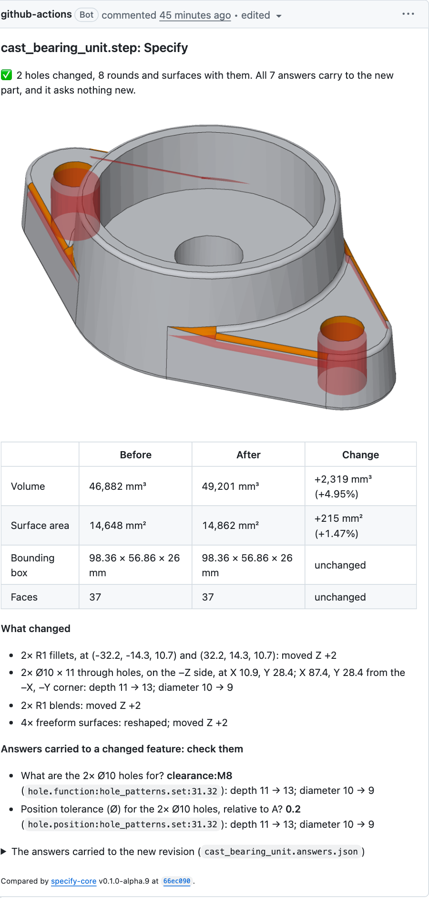

# Specify

Specify adds manufacturing intent to STEP parts and keeps it with the part as the model
changes.

- **It specifies a part.** It recognises the part's features (holes, threads, slots, bosses,
  turned diameters) and asks what a drawing would need to say: the material, what each hole is
  for, which faces are datums, the fits, threads, positions, finish and general tolerance. Each
  question comes with a proposed answer and the reason for it. It writes the answers into the
  STEP file as AP242 semantic PMI, and verifies the file by reading it back.
- **It reviews a revision.** Given two versions of a part, `diff` says what changed, in words
  a person can check against the model, draws the change, and carries the answers to the new
  revision. Nothing is guessed: an answer it can't place is listed, never silently moved.
- **It comments on pull requests.** The [STEP diff action](step-diff/README.md) puts that review
  on each GitHub pull request that changes a STEP file.



Specify is one engine for three front ends: a command line, a JSON-lines service and a
WebAssembly module, which the Specify editor at [draftwright.io](https://draftwright.io) runs
in the browser. It is pure Rust, with no OpenCascade or Python. Feature recognition and the STEP and
AP242 kernel come from [quiddity-rust](https://github.com/pzfreo/quiddity-rust).

Specify began as a port of the Python [specify-core](https://github.com/pzfreo/specify-core),
and still reads and writes the same files; see [docs/python.md](docs/python.md).

## Status

Alpha: **0.1.0-alpha.9**. Interfaces and answer IDs can still change between releases; see
[CHANGELOG.md](CHANGELOG.md). What each part does and how it's verified is in
[docs/design.md](docs/design.md).

## Install

Each [release](https://github.com/pzfreo/specify-core-rust/releases) has the command line for
Linux (x86_64), macOS (Apple Silicon) and Windows (x86_64), each with a SHA-256 checksum:

```bash
v=v0.1.0-alpha.9; t=aarch64-apple-darwin   # or x86_64-unknown-linux-gnu
gh release download $v -R pzfreo/specify-core-rust -p "specify-core-$v-$t.tar.gz*"
shasum -a 256 -c specify-core-$v-$t.tar.gz.sha256 && tar -xzf specify-core-$v-$t.tar.gz
./specify-core-$v-$t/specify-core --help
```

On Windows, the `.zip` holds `specify-core.exe`. To build from source with Rust 1.99
(`rust-toolchain.toml`):

```bash
cargo build --release          # target/release/specify-core
```

## Specify a part

```bash
specify-core analyse part.step -o analysis.json               # its features and existing PMI
specify-core questions analysis.json --answers a.json --open  # what is still unanswered
specify-core write part.step analysis.json a.json -o out.step --accept-defaults
```

- **Answers:** `a.json` maps each question id to its answer, for example
  `{"part.material": "6082-T6", "hole.function:hole_patterns.grid:…": "fit:H7"}`.
- **Writing:** `write` refuses until every question has an answer, or a default with
  `--accept-defaults`. It then writes AP242 into the original document and checks it by reading
  it back. It prints a JSON report (`output`, `written`, `not_written`, `warnings`).
- **Resuming:** the answers are stored in the file too, so a later `analyse` resumes them.
- **Exit codes:** 0 done; 1 for a write that didn't verify, or a file that can't be read; 2 for
  a refusal (unanswered questions, an invalid answer, bad arguments).

`specify-core mesh part.step -o part.mesh.json` writes the part's triangles by face, for a
picker that selects faces.

### Assemblies

An assembly is specified a part at a time. `parts` lists its distinct parts (a part placed twice is
one part with two placements). `analyse` and `mesh` take `--part N`. `write` takes an analysis and
answers for each part and writes them all at once, each part's PMI on its own product definition:

```bash
specify-core parts asm.step
specify-core analyse asm.step --part 0 -o plate.json
specify-core analyse asm.step --part 1 -o pin.json
specify-core write asm.step plate.json plate-a.json pin.json pin-a.json -o out.step --accept-defaults
```

Writing a part again replaces its PMI and answers. A part written alone
(`write asm.step pin.json pin-a.json -o out.step`) leaves the other parts as they were.

## Review a revision

```bash
specify-core diff old.step new.step --answers old.answers.json -o changes
```

`changes/` gets:

- `report.md`, the review, written to be posted as a pull request comment;
- `model.png`, the new part with changed faces orange, new faces green, and the old part's gone
  or moved faces in translucent red;
- `answers.json`, the answers carried to the new revision, to commit;
- `report.json`, all of the above as data.

Without `--answers`, the answers Specify stored in the old file are carried.
[docs/diff.md](docs/diff.md) explains how the two parts are matched and what carries.

To have the review posted on every pull request, add the [STEP diff action](step-diff/README.md):

```yaml
      - uses: pzfreo/specify-core-rust/step-diff@main
```

[pzfreo/step-diff-demo](https://github.com/pzfreo/step-diff-demo) is a working example.

## In the browser and in other programs

- **WebAssembly:** each release attaches `specify-core-wasm-<version>.tgz`, an ES module with
  TypeScript types, and its checksum. `IntentEngine` opens STEP bytes, returns the analysis,
  questions and review as JSON, and writes verified PMI. The API, install and checks are in
  [docs/wasm.md](docs/wasm.md).
- **Service:** `specify-core serve` answers JSON-line requests on stdin, one reply per line on
  stdout, for a host process. Its ops are `parts`, `analyse`, `questions`, `preview`, `interpret`
  and `write`; the protocol is in `src/serve.rs`.

  ```bash
  echo '{"id": 1, "op": "analyse", "step": "part.step"}' | specify-core serve
  ```

- **Rust library:** [docs/library.md](docs/library.md).

## More

| | |
| --- | --- |
| [docs/diff.md](docs/diff.md) | how revisions are compared and answers carried |
| [step-diff/README.md](step-diff/README.md) | the pull request action |
| [docs/wasm.md](docs/wasm.md) | the WebAssembly module |
| [docs/library.md](docs/library.md) | the Rust API |
| [docs/part-notes.md](docs/part-notes.md) | part notes in the STEP file |
| [docs/design.md](docs/design.md) | design and status |
| [docs/python.md](docs/python.md) | the Python specify-core: compatibility and differences |
| [docs/questions.md](docs/questions.md) | decisions taken and open |

## Tests

```bash
cargo test --release
SPECIFY_CORPUS=/path/to/quiddity/tests/corpus cargo test --workspace --release   # with the corpus
```

CI runs the whole workspace against the pinned corpus with `QUIDDITY_CORPUS_REQUIRED=1`, which
fails when the corpus or a captured input is missing. Set it locally to require the same.
Comparisons with the Python implementation are described in [docs/python.md](docs/python.md#tests).

## Licence

AGPL-3.0-or-later; see [LICENSE](LICENSE) and [NOTICE](NOTICE).
